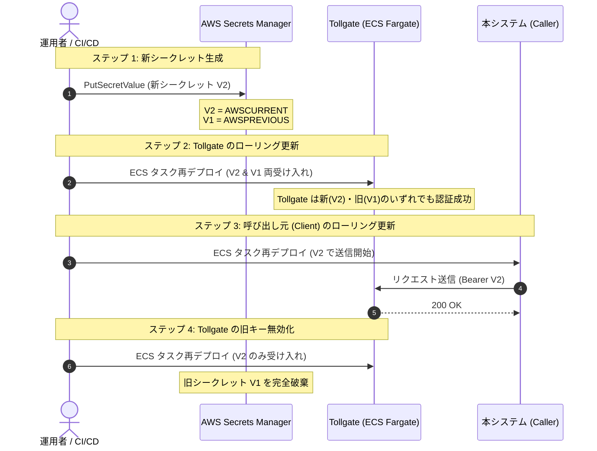

# 共有シークレット・マスターキー ローテーション手順書 (Secret Rotation Guide)

本書は、Tollgate の管理マスターキー（`ADMIN_API_KEY`）や共有認証シークレットをダウンタイムゼロで安全にローテーションするための運用手順を定める（要件 C-2）。

---

## 1. 概要とローテーション方針

Tollgate は管理用 Web API（`/v1/admin/*`）の保護に `ADMIN_API_KEY` を使用する。
また、本システム（テナント管理サービス・BFF）との間で共有される認証シークレットを更新する際は、**新旧両バージョンのシークレットを一時的に併用しながらローリング再デプロイを行う方式**を採用する。

### 基本原則
1. **ダウンタイムゼロ**: シークレット更新中に正規のリクエストが 401 Unauthorized で拒絶されてはならない。
2. **Secrets Manager のバージョンステージング**: AWS Secrets Manager の `AWSCURRENT` と `AWSPREVIOUS` を活用。
3. **Fail-Fast**: 環境変数やシークレットが未設定の場合はハードコードされたデフォルト値にフォールバックせず、即座に起動エラーまたは 401 拒絶とすること。

---

## 2. AWS Secrets Manager を用いたローテーション手順



---

## 3. 具体的な作業手順

### ステップ 1: AWS Secrets Manager で新シークレットの登録
1. 新しいセキュアなランダム文字列（32文字以上、暗号学的に安全な乱数）を生成する。
   ```bash
   NEW_SECRET=$(openssl rand -hex 32)
   ```
2. Secrets Manager のシークレットを更新する。
   ```bash
   aws secretsmanager put-secret-value \
     --secret-id tollgate/admin-api-key \
     --secret-string "{\"ADMIN_API_KEY\":\"${NEW_SECRET}\"}"
   ```
   *これにより、直前のシークレットには自動的に `AWSPREVIOUS` ステージラベルが付与される。*

---

### ステップ 2: Tollgate 側への新シークレット反映（併用モード）
Tollgate では、ローテーション移行期間中に新旧両方のシークレットを検証可能にするため、カンマ区切りまたはセカンダリ環境変数（`ADMIN_API_KEY_PREVIOUS`）を受け入れる。

1. ECS タスク定義の環境変数に新旧両方を設定する：
   - `ADMIN_API_KEY`: Secrets Manager の `AWSCURRENT`
   - `ADMIN_API_KEY_PREVIOUS`: Secrets Manager の `AWSPREVIOUS`
2. Tollgate サービスをローリングアップデート（`UpdateService`）し、全タスクを新タスク定義へ切り替える。
3. **確認**: 旧シークレットおよび新シークレットの双方で `/v1/admin/health` または `/v1/admin/stats` の認証が通ることを確認。

---

### ステップ 3: 呼び出し元（本システム・BFF）のローリング更新
1. 呼び出し元サービス（テナント管理サービス等）の環境変数を新シークレット（`AWSCURRENT`）に切り替える。
2. 呼び出し元サービスをローリング再デプロイ。
3. **確認**: 呼び出し元からの管理 API 呼び出しがすべて正常（200 OK）に疎通していることを CloudWatch メトリクス等で確認。

---

### ステップ 4: Tollgate から旧シークレットの除去
1. 全呼び出し元が新シークレットへ移行したことを確認後、Tollgate のタスク定義から `ADMIN_API_KEY_PREVIOUS` を削除（または空に設定）。
2. Tollgate サービスを再度ローリング再デプロイ。
3. **確認**: 旧シークレットを用いたリクエストが期待通り `401 Unauthorized` で拒絶されることを確認。

---

## 4. トラブルシューティング & ロールバック

もしステップ 3 の呼び出し元切り替え中に不具合が発生した場合：
1. **即時ロールバック**: 呼び出し元サービスを直前のタスク定義（旧シークレット使用版）へロールバックする。
2. Tollgate 側はステップ 2 で新旧両方を受け入れる状態を維持しているため、呼び出し元が旧シークレットに戻ってもサービス停止は発生しない。
3. 原因究明後、再度ステップ 3 を実施する。
